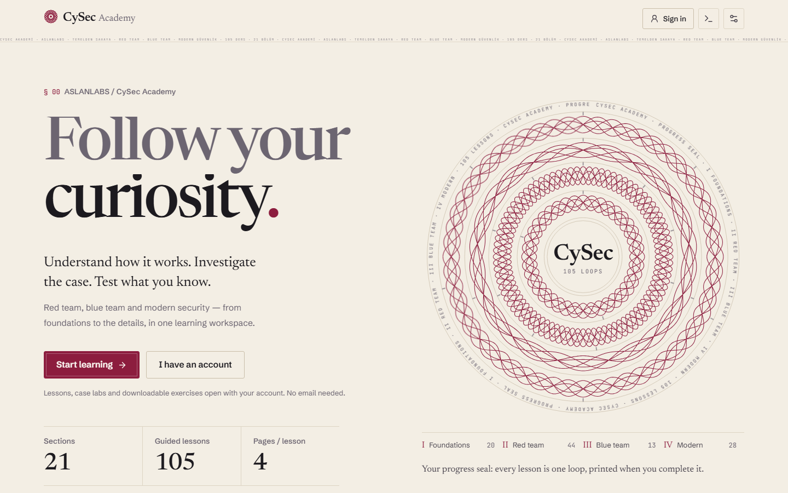
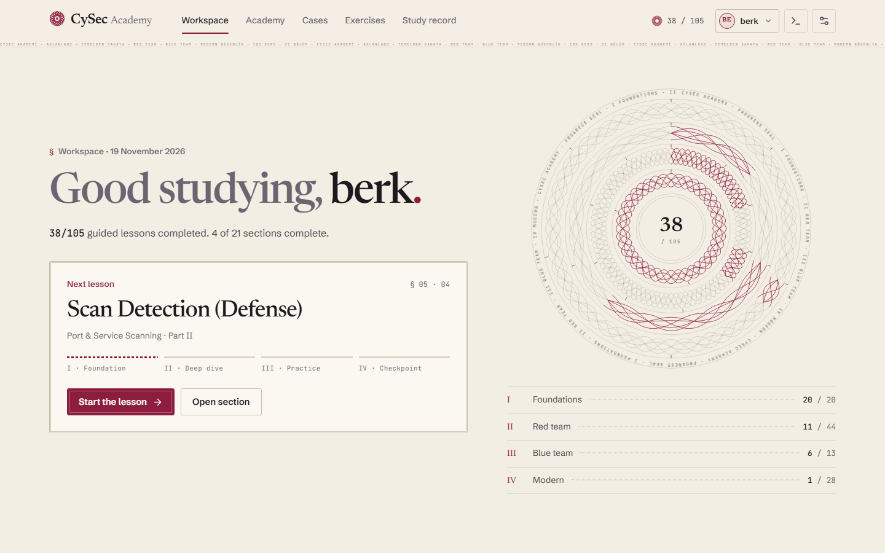
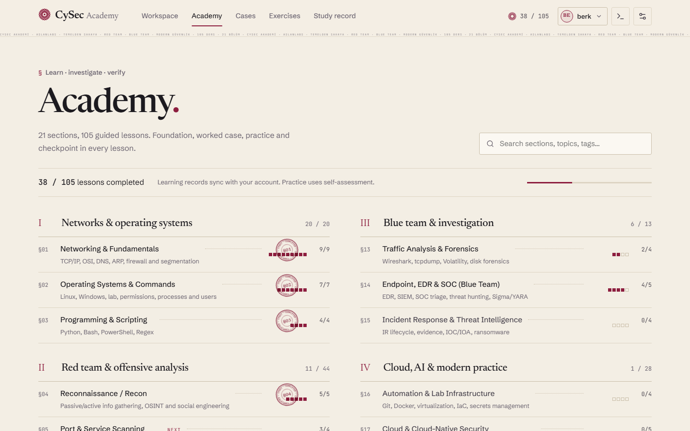
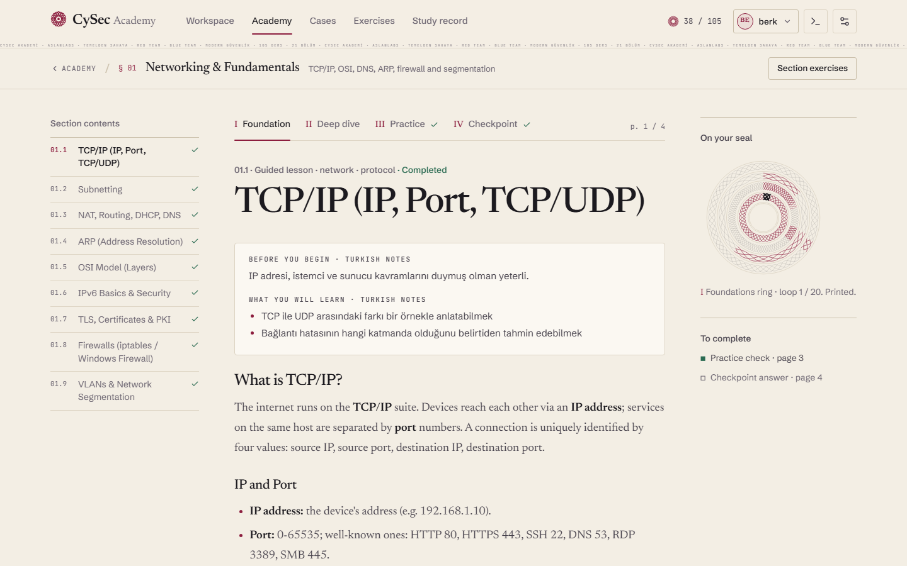
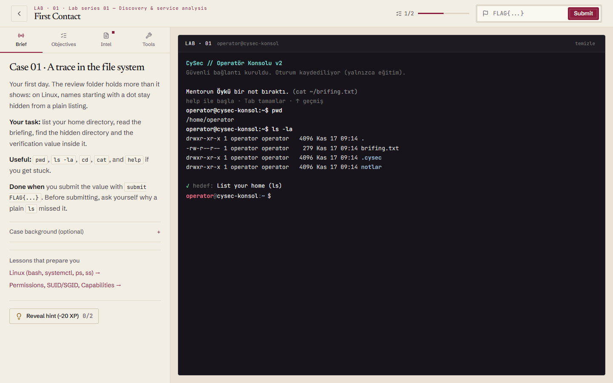

# CySec Academy

**A cybersecurity study workspace.** Learn how it works, investigate the case, test what you know.

[**cysec.aslanlabs.online**](https://cysec.aslanlabs.online) · Turkish and English interface · closed source

<picture>
  <source media="(prefers-color-scheme: dark)" srcset="assets/screens/landing-dark.png">
  
</picture>

> [!NOTE]
> This repository is a showcase of the live site; the source code is private.

## What's inside

- **105 guided lessons in 21 sections**, grouped into four parts: Foundations (20),
  Red team (44), Blue team (13) and Modern security (28).
- **Four pages per lesson.** The foundation, a deep dive into the mechanism with a
  worked case, hands-on practice with the expected result and a self-check, and a
  checkpoint question that explains every answer.
- **Case labs.** Short investigations in a terminal simulated in the browser: read the
  brief, follow the traces, submit the flag. Targets and data are fictional.
- **Exercises.** A quiz per section with multiple choice, true/false, fill in the blank
  and real command writing.
- **Study record.** Every finished lesson prints one loop on your progress seal, and
  every finished section earns a stamp.
- **Accounts without email.** A username and password; progress syncs across devices.
- **Three themes.** Night, Ivory and Hacker, with five accent colours, a larger text
  size and a reduced-effects switch.

## Screens

<table>
<tr>
<td width="50%"><picture><source media="(prefers-color-scheme: dark)" srcset="assets/screens/workspace-dark.png"></picture></td>
<td width="50%"><picture><source media="(prefers-color-scheme: dark)" srcset="assets/screens/academy-dark.png"></picture></td>
</tr>
<tr>
<td><b>Workspace</b>: the next lesson, the seal and where you stand in each part.</td>
<td><b>Academy</b>: the table of contents, one square per lesson and a stamp per finished section.</td>
</tr>
<tr>
<td><picture><source media="(prefers-color-scheme: dark)" srcset="assets/screens/lesson-dark.png"></picture></td>
<td><picture><source media="(prefers-color-scheme: dark)" srcset="assets/screens/case-dark.png"></picture></td>
</tr>
<tr>
<td><b>Lesson</b>: four pages, the section's contents and the lesson's loop on the seal.</td>
<td><b>Case lab</b>: a brief, objectives and a simulated terminal.</td>
</tr>
</table>

Screenshots use a local copy of the site with a sample account and follow your GitHub theme.

## Design: Mühür

The interface borrows from security printing: guilloche loops, microtext, serial
numbers and stamps, the things that make banknotes and passports hard to fake. The
progress seal has four rings, one per part, and each lesson is a single loop on it.
Lessons read like a book in Newsreader, the interface is set in Schibsted Grotesk and
serials and terminals in JetBrains Mono, on ivory or night paper with one claret accent.

## Scope

Red-team lessons explain how attacks work so you can recognise and stop them. Practice
runs on your own virtual machines or deliberately vulnerable apps such as OWASP Juice
Shop, and case labs use fictional targets only.

Built with React, Vite, Cloudflare Workers and D1.

## Türkçe

CySec Akademi, siber güvenliği temelden ayrıntıya öğreten bir çalışma alanı: 21 bölümde
105 rehberli ders, simüle terminalde vaka labları ve bölüm alıştırmaları. Site
[cysec.aslanlabs.online](https://cysec.aslanlabs.online) adresinde yayında; kaynak kodu
kapalı.

---

© 2026 Berk Talha Aslan. All rights reserved.
